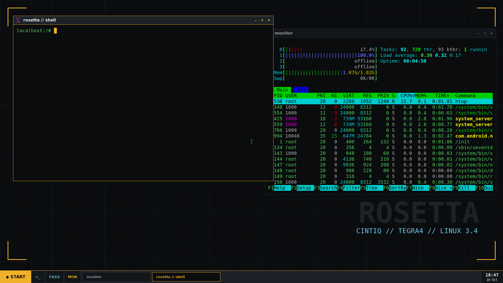
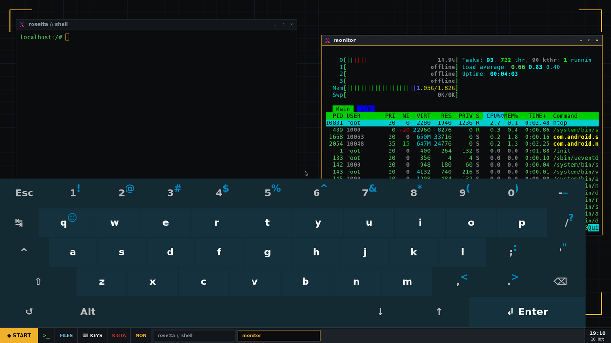
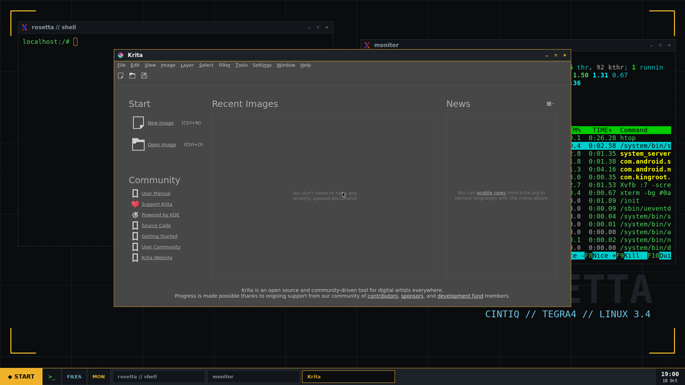
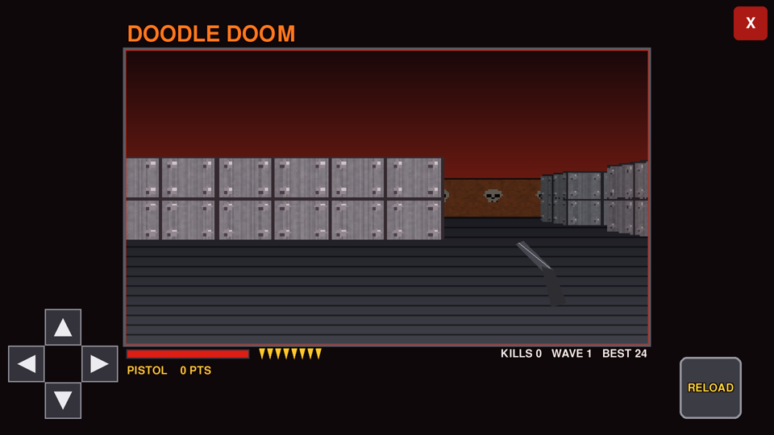
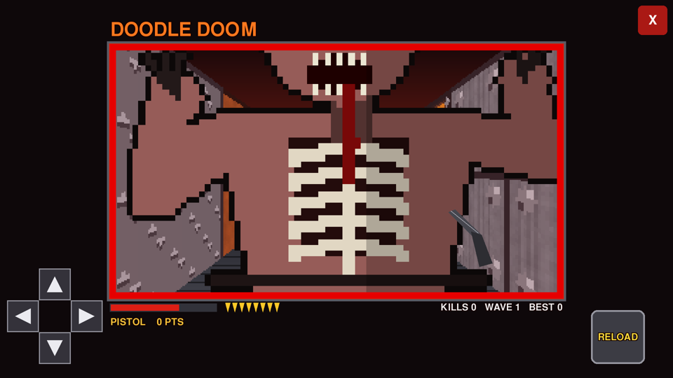

# Cintiq Hybrid Linux  (WIP)

Give the **Wacom Cintiq Companion Hybrid** (DTH-A1300, the Android one with the Tegra 4) a second life:

* **Real Linux on the tablet's own screen**: native X with the Wacom driver (**real pen pressure in Krita**), touch with
  pinch-zoom, the hardware buttons, calibration, on-screen keyboard, rotation, Wi-Fi, a metal zombie shooter.
* **Rosetta Screen**: the tablet as a **wireless pen display for your PC**, decoded on the Tegra's hardware video
  decoder, with pressure, hover, eraser and touch going back to Windows. It finds your PC on any Wi-Fi by itself,
  and the video is AES-encrypted, so it can even run from outside your home.
* **A boot menu** on every power-on: *Wireless screen*, *Linux desktop* or *Android*. No PC needed to switch.

No bootloader unlock and no custom kernel. Android stays on the tablet untouched; Linux boots from the *recovery* slot.

> **Made by JunkSmithWizard (JSW) together with Claude (Anthropic's AI).** Claude wrote the code, the installer and
> the Android app. JSW owned the hardware, tested every step on the real tablet and made the calls that cracked it:
> "just modify the kernel", "the panel is switched, so find another way", "stop faking it, I want it on the real
> screen", and later "dig deeper" until the wireless screen had no noticeable lag.

**Unofficial. Not affiliated with, or endorsed by, Wacom.** Flashing a partition can brick a device. Read
[Risks and Recovery](#risks-and-recovery) first.

## Quick start (Windows)

You need: the tablet with **root** (see [docs/ROOT.md](docs/ROOT.md)), USB debugging on, the tablet on **Wi-Fi**,
and Python 3.8+ on the PC.

1. Download this repo (green **Code** button > *Download ZIP*) and unzip it.
2. Plug the tablet in (in Android mode) and accept the USB-debugging prompt on it.
3. Double-click **`install.bat`** and type `YES` when asked. (`install.bat --krita` adds Krita.)

It backs up your original recovery, downloads what it needs, installs the desktop, flashes the Linux image
(verified byte for byte) and boots Linux. The first boot returns to Android by itself after about 4 minutes, so you
can never get stuck.

| Command | What it does |
|---|---|
| `install.bat` | Install everything and boot Linux once |
| `install.bat boot` | Boot the Linux desktop again |
| `install.bat stay` | Linux stays up until you power-cycle (no auto-return) |
| `install.bat unstay` | Back to the safe 4-minute auto-return |
| `install.bat restore` | Put your original recovery partition back |

### The wireless screen (Rosetta Screen)

1. **Install the app**: get `RosettaScreen.apk` from the [Releases](../../releases) page (or build it, see
   [android/](android)), copy it to the tablet and open it with the file manager. (KingRoot blocks `adb install`;
   the normal installer screen works.)
2. **Pair** (once): `python pc/pair.py` with the tablet plugged in. It makes the shared secret and writes the
   tablet's config. Add `--remote your-home.duckdns.org` to use it away from home.
3. **Give Windows a second screen**: install the free [Virtual Display Driver](https://github.com/VirtualDrivers/Virtual-Display-Driver)
   (`winget install VirtualDrivers.Virtual-Display-Driver`, then *Install* in its VDD Control app), set the new
   screen to **1920 x 1080** and *Extend these displays*.
4. Run **`pc/start_rosetta_screen.bat`**, then pick **WIRELESS SCREEN** on the tablet.

The pen draws on that screen, with pressure. Fingers tap, drag and scroll (ignored while the pen is near, so you can
rest your hand).

| Tablet button | In the wireless screen |
|---|---|
| Search | switch between **extending** (the second screen) and **mirroring** your main screen; pen and touch follow |
| Menu | the tablet's keyboard on / off |
| Volume + / − | undo / redo |
| Back | exit |

**Keyboard:** tap a text box on the PC with a finger or the pen and the tablet's own keyboard pops up (æ ø å,
symbols, arrows, Ctrl and Shift, Shift twice for caps lock). If the keyboard would cover the box, the picture slides
up. The PC finds text boxes through Windows UI Automation (`pc/focuswatch.cs`, compiled on first run with the C#
compiler that comes with Windows). A few apps don't report their text areas (Word's page, for one): use Menu there.
Typed text is never logged.

**Mirror** shrinks a 4K main screen to the tablet's 1920 x 1080 on the CPU, so it costs a bit more CPU than extending.

**Away from home:** forward **UDP 5600-5601** on your router to the PC, pair with `--remote`, and run
`pc/start_rosetta_remote.bat` (30 fps, 6 Mbit/s for home upload speeds). Public Wi-Fi that isolates devices can't
work; a phone hotspot can.

## The boot menu

<b>WIRELESS SCREEN</b> &nbsp;·&nbsp; <b>LINUX DESKTOP</b> &nbsp;·&nbsp; <b>ANDROID</b>

The Rosetta Screen app shows this menu on every power-on (also from its *Rosetta Menu* icon). *Linux desktop* reboots
straight into Linux, no PC or adb needed. From Linux, *Return to Android* in the START menu (or holding power) comes
back.

## Screenshots

*The on-screen keyboard (KEYS button, or the Home button).*

*Krita on the tablet. With native X it gets the pen's real pressure.*

*DOODLE DOOM: an endless zombie horde in a round metal arena. Start with a pistol, buy better guns off the walls
further out (shotgun, flying-V lightning, hellcannon). Tap to shoot, drag to steer, the rocker ring moves you.*

*The look follows the U110 RomHex Studio / Rosetta ROM tools: dark panel, amber accents, phosphor-green terminal.*

## What works in Linux

| | |
|---|---|
| **Screen** | Native X (Xorg + fbdev) on the panel; only changed areas are copied, ~0% CPU at idle |
| **Pen** | Wacom X driver: **real pressure** for Krita and friends; 5-point calibration, ◀ ▲ ▼ ▶ nudge |
| **Touch** | Tap / drag, two-finger pinch zoom and pan (Krita) |
| **Buttons** | All eight Hybrid buttons, remappable in `/root/keymap.txt` |
| **Rotation** | ROT button: landscape, portrait, flipped (the desktop restarts; windows re-arrange) |
| **Wi-Fi** | Uses the networks Android knows; asks the router for the same address every time |
| **Power** | Battery % and brightness on the taskbar (scroll = dim), idle dimming, CPU in performance mode |
| **Memory** | Frees the ~700 MB the Tegra graphics driver reserves: ~1.5 GB free for apps |
| **PC mode** | PC button / Back: your PC on the panel, the pen draws on the PC (software decoding, ~0.3 s lag) |
| **Apps** | Terminal, files, editor, htop, Krita (`--krita`), DOODLE DOOM; `apk add chromium mpv mupdf` for more |
| **SSH** | Optional, over USB only: put your key in `/data/local/ssh/authorized_keys` |
| **Safe** | Android untouched; a normal power-on is Android; a watchdog returns to Android in test mode |

### Hardware buttons (Linux)

| Button | Default action |
|---|---|
| Home (middle) | show / hide the keyboard (in PC mode: Windows' keyboard) |
| Volume + / − | undo / redo |
| Brightness − / + | brush smaller / bigger |
| Search | eraser (`E`) |
| Menu | brush (`B`) |
| Back | PC mode on / off |

## How it works

The panel is **hardware-switched** between the tablet's own SoC and your PC (that's how the Hybrid works as a
Cintiq). If Android's display stops, the switch falls back to the PC input, so a plain "stop Android and draw to the
framebuffer" never reaches the panel. In the stock *recovery* mode the panel does show the framebuffer if the mode is
set the way recovery sets it. So:

1. A custom ramdisk replaces the one in your **recovery** image (kernel and header stay byte-identical).
2. It starts USB-adb, mounts an Alpine Linux root filesystem from the data partition, loads the Wi-Fi driver from
   Android's system partition, and starts **Xorg** on the framebuffer with the Wacom input driver.
3. Xorg writes pixels with the alpha byte at 0, which this panel shows as transparent. A small pusher copies only the
   areas X reports as changed (XDamage) onto the second framebuffer page with alpha set, and shows that page.
4. A bridge reads the finger, the buttons and (in PC mode) the pen straight from evdev.

**Rosetta Screen** is a 25 KB Android app. The PC captures the second screen on the GPU (`ddagrab`), encodes H.264
(`x264` zerolatency), encrypts it (AES-256-CTR, Windows' own crypto) and sends whole frames as numbered UDP
fragments. The app puts complete frames into the Tegra's hardware decoder and drops late ones instead of queueing
them. It draws in an overlay window above the Android system bar, so the video goes straight to the panel. Pen,
touch and keys go back as HMAC-signed packets; the PC injects them as a real Windows pen (pressure, eraser, barrel
button) and touch.

Measured with the probes in `pc/` (a square flips on the PC, the tablet reports when it has decoded it): the app
takes **89 ms** median (85-100 ms) from the change on the PC to the decoded frame on the tablet, plus at most one
screen refresh to show it. The Linux-mode software decoder takes about 335 ms. To repeat it: create
`/sdcard/rosetta/probe` on the tablet, restart the app and run `python pc/latency_probe.py`.

## Risks and Recovery

* The installer writes **one partition: the recovery slot (`SOS`)**, after saving your original to `backups/SOS.img`.
  Android lives on a different partition and is never written.
* A normal power-on never reads the recovery slot, so it boots Android (and shows the boot menu once the app is in).
* Every Linux boot clears the recovery flag first, and a watchdog reboots to Android after ~4 minutes unless you
  ran `stay`. **To leave Linux any time:** START menu > *Return to Android*, or hold power ~10 s then power on.
* **Put everything back:** `install.bat restore` writes your original recovery partition back.
* If you ever land on the Android robot with "No command": hold **Power** and tap **Volume Up** to open the recovery
  menu, then pick *reboot system now*.
* The wireless screen only accepts input signed with your secret (`pc/secret.txt`, never share it). Away-from-home
  use opens two UDP ports; the video is encrypted and input without the secret is ignored.
* Use at your own risk. No warranty (MIT).

## Status: work in progress 🚧

* Rotation restarts the desktop (the fbdev driver can only rotate at start).
* PC mode inside Linux decodes video on the CPU (~0.3 s lag); the Android app is the fast path.
* No Linux GPU driver for the Tegra 4 here: apps draw in software (Krita works, big canvases are slow).

## Legal

Unofficial hobby project, not affiliated with Wacom. "Wacom" and "Cintiq" are trademarks of their owners, used here
only to say what the software works with. **No Wacom or NVIDIA firmware is in this repo:** the installer saves
*your own* recovery partition and builds from it, the Wi-Fi driver and firmware are loaded from *your* tablet's
Android at run time, and everything else (busybox, Alpine Linux, Xorg, Krita, ffmpeg and the other packages) is
downloaded from its official source at install time under its own licence. The Virtual Display Driver is a separate
project under its own licence. The code in this repo is under the MIT License ([LICENSE](LICENSE)).

Made with love for a tablet that deserved better software. Pull requests and reports from other Hybrids welcome.
