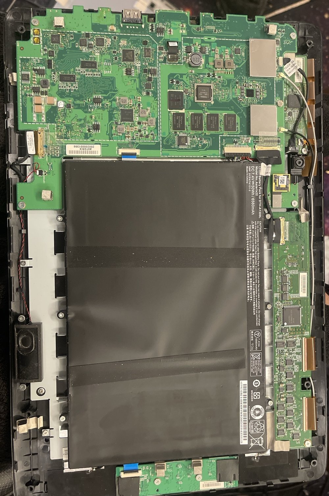
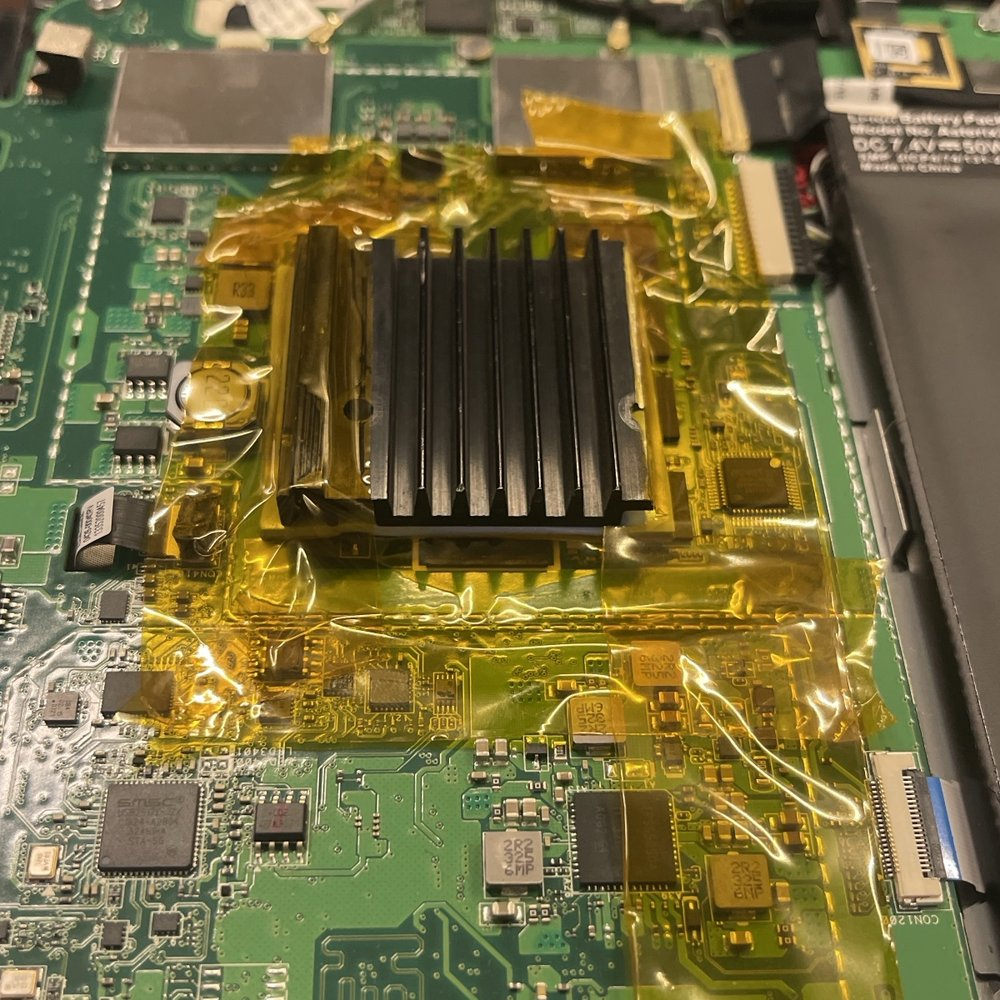
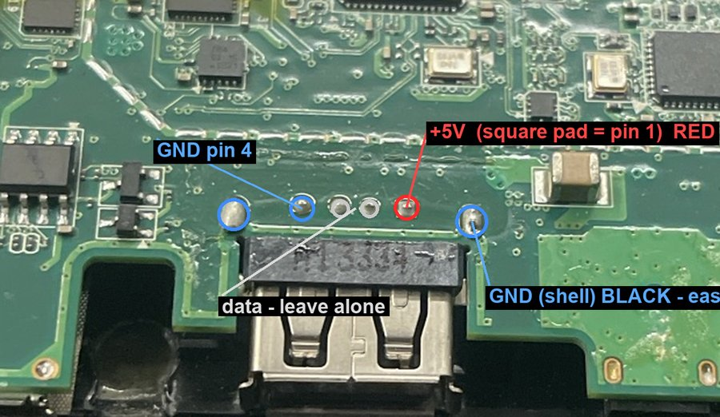
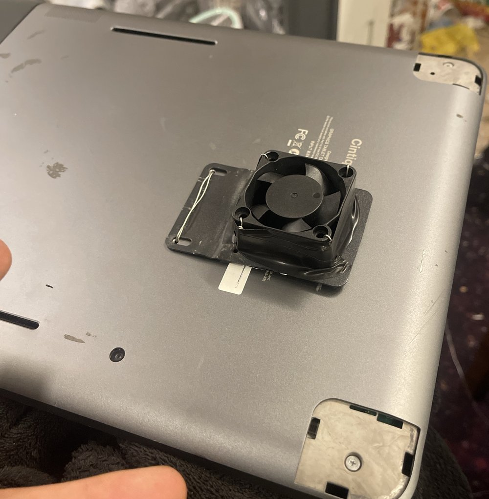

# Active cooling mod (optional)

**The Tegra 4 in the Cintiq Companion Hybrid has no cooling at all.** No heatsink, no thermal pad, nothing touching
the chip. Android protects itself by slowing the CPU down, and after about 20 minutes of drawing over Rosetta Screen
that is exactly what you feel: it starts fine, then the picture falls further and further behind.

JSW opened the tablet, put a heatsink on the chip and a 5 V fan on the back. Result: **from 69 °C and throttling to
52-55 °C at full clock, for hours.**

> Video of the whole mod: *coming soon on JSW's YouTube channel.*

## Before and after (measured on the tablet)

| | before (no cooling) | after (heatsink + fan) |
|---|---|---|
| CPU temperature | 69-78 °C | 49-55 °C |
| CPU clock after 20+ min | dropped 1224 → 612 MHz | 1810 MHz (stock maximum), steady |
| Rosetta Screen lag | 250-500 ms behind, constant catch-ups | 2-30 ms, zero catch-ups in 2 hours |

The lag tracked the clock: below ~750 MHz the app fell behind live. Readings came from the tablet's own sensors
(`/sys/class/thermal`) and the app's `/sdcard/rosetta/diag.txt` log.

## What you need

* a small aluminium heatsink, cut to sit on the Tegra only
* a thermal pad (JSW used the blue pad from a Raspberry Pi CM4 heatsink kit)
* Kapton tape
* a **5 V** fan (JSW: 40 x 40 x 20 mm) and a bit of wire
* a Dremel or similar for the back plate
* optional: the printed fan grille in [`hardware/fan_grille/`](../hardware/fan_grille/)

## Steps

### 1. Open it and find the Tegra



The Tegra 4 is the square chip with the NVIDIA logo in the middle of the board, with the four SK Hynix RAM chips
just below it. It is bare. The big battery sits right underneath the board, so the chip's heat used to go straight
into it.

### 2. Heatsink on the chip



* Cut the heatsink so it covers **only the chip area**. Keep it off the battery.
* Thermal pad between the chip and heatsink. Thermal pads like this are not electrically conductive.
* Kapton tape over the cut edges and to hold it in place.
* **Don't press on the board.** The display is right behind it, and pressing once made the chip's own temperature
  sensors read 0 until a reboot. The heatsink only needs light contact.

### 3. Power for the fan: the USB-A port



Behind the full-size USB port on the board: the **square pad is pin 1 = +5 V** (red wire), and the big shell
solder blobs either side are **ground** (black wire). The two middle pads are data, so leave them alone. Check with a
meter (about 5 V with the tablet on) before you solder. A small fan draws ~0.1 A, well inside what the port gives.

### 4. Fan on the back plate



* Take the back plate **off the tablet** before cutting, so no metal dust lands on the board.
* Cut a hole over the heatsink with a Dremel. The fins can stick up into it.
* Fan **blowing in**, onto the fins. JSW left it slightly off flush on purpose: the air hits the fins and escapes
  out through the gap instead of being pushed into a closed case.
* Mount it to the plate (wire through the fan's corner holes works), so nothing hangs on the chip.

### 5. Optional: printed grille


[`fan_grille_40mm_emblem.stl`](../hardware/fan_grille/fan_grille_40mm_emblem.stl): a 40 mm grille with JSW's own
horned-skull emblem over swept turbine blades. Made for a 0.8 mm nozzle (2.5 mm blades, holes kept ≥ 1.8 mm apart).
Print flat, emblem up, no supports, 0.2 mm layers, rigid filament (PETG).

## Optional software tweak

With the fan the chip has lots of headroom, so the CPU can stay at its stock maximum instead of the lower clock
Android picked. As root on the tablet:

```sh
echo performance > /sys/devices/system/cpu/cpu0/cpufreq/scaling_governor
```

This is the **stock** 1.81 GHz, not an overclock, and it resets on reboot. The fan uses about 0.5 W, roughly 1-2 %
battery per hour; max clock costs a bit more than that. The battery also ages slower now that it isn't sitting
next to a 75 °C chip.

**At your own risk.** Opening the tablet, soldering and cutting the case void any warranty and can damage it.
